<p align="center">
  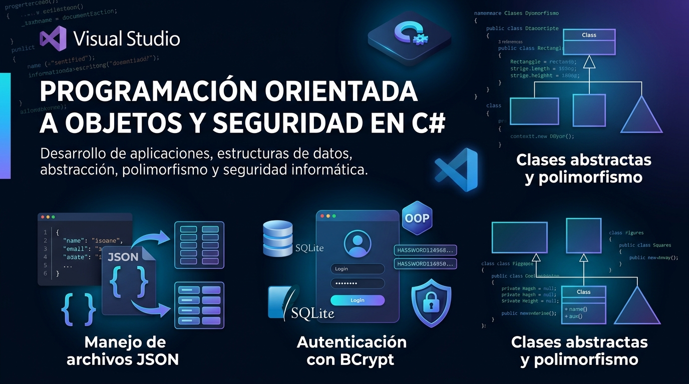
</p>

<h1 align="center">🎓 HPA 3 · Parcial #3</h1>

<p align="center">
  Tres proyectos en <b>C# / .NET 10</b>: clases abstractas con polimorfismo, serialización JSON y un login seguro con BCrypt + SQLite.
</p>

<p align="center">
  
  
  
  
  
  
</p>

---

## 📑 Índice

1. [Resumen de proyectos](#️-resumen-de-proyectos)
2. [Proyecto 1 – Clase abstracta](#-proyecto-1--clase-abstracta-figuras-geométricas)
3. [Proyecto 2 – JSON](#-proyecto-2--serialización-json)
4. [Proyecto 3 – LoginBCrypt](#-proyecto-3--loginbcrypt-login-seguro)
5. [Cómo ejecutar](#️-cómo-ejecutar)
6. [Estructura del repositorio](#-estructura-del-repositorio)

---

## 🗂️ Resumen de proyectos

| # | Proyecto | Tipo | Tema principal | Carpeta |
| :-: | :-- | :-- | :-- | :-- |
| 1 | 📐 Clase abstracta | Consola | Herencia, abstracción y polimorfismo | `Problema # 1- Clase abstracta/` |
| 2 | 🧾 JSON | Consola | Serialización con Newtonsoft.Json | `Problema #2 - JSON/` |
| 3 | 🔐 LoginBCrypt | Windows Forms | Autenticación, hashing BCrypt y SQLite | `LoginBCrypt/` |

---

## 📐 Proyecto 1 – Clase abstracta (figuras geométricas)

### 📝 Descripción
Aplicación de consola que modela figuras geométricas mediante una **clase abstracta `Figura`** y calcula el área y el perímetro de cada una recorriendo un arreglo de manera polimórfica.

### 🛠️ Tecnologías
 

### ⚙️ Cómo funciona
1. `Program.cs` crea un arreglo `Figura[]` con un `Rectangulo(10, 5)`, un `Cuadrado(4)` y un `Triangulo(6, 5, 5, 4)`.
2. Un `foreach` recorre el arreglo y llama a `CalcularArea()` y `CalcularPerimetro()` sobre cada elemento.
3. Cada objeto ejecuta **su propia** implementación (polimorfismo) y se imprime el nombre de la clase con `GetType().Name`.

### 🧩 Clases principales

| Clase | Rol | Atributos | Fórmulas |
| :-- | :-- | :-- | :-- |
| `Figura` | Clase abstracta base | — | Declara `CalcularArea()` y `CalcularPerimetro()` abstractos |
| `Rectangulo` | Hereda de `Figura` | base, altura | Área = b·h · Perímetro = 2(b+h) |
| `Cuadrado` | Hereda de `Figura` | lado | Área = l² · Perímetro = 4l |
| `Triangulo` | Hereda de `Figura` | lado1, lado2, lado3, altura | Área = (lado1·altura)/2 · Perímetro = suma de lados |

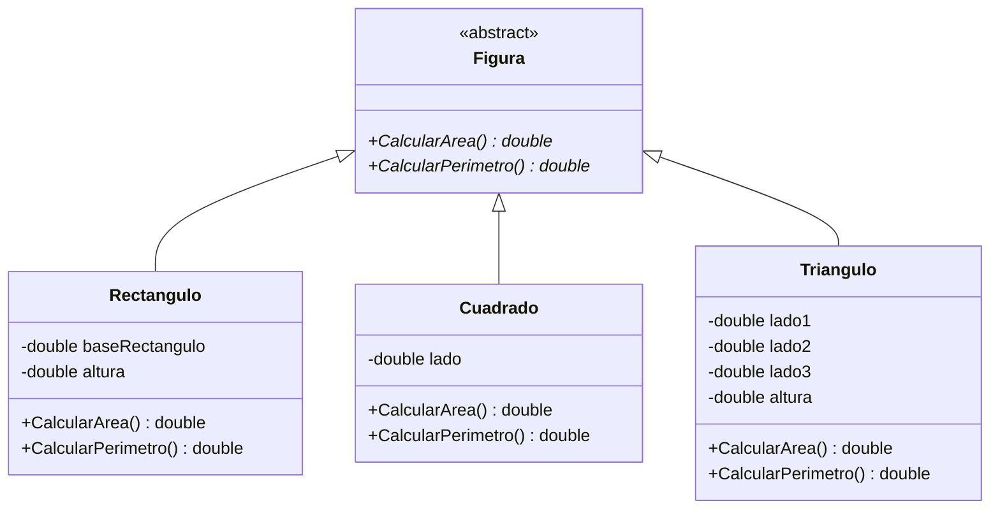

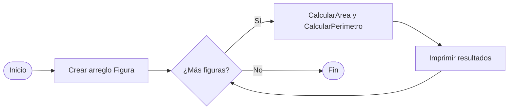

### 🖥️ Salida esperada

| Figura | Área | Perímetro |
| :-- | :-: | :-: |
| Rectangulo | 50 | 30 |
| Cuadrado | 16 | 16 |
| Triangulo | 12 | 16 |

### 🧠 Conceptos implementados
`Clase abstracta` · `Métodos abstractos` · `Herencia` · `override` · `Polimorfismo` · `Encapsulación (campos private)` · `Arreglos` · `foreach` · `GetType()`

### 📸 Capturas

| Código | Ejecución |
| :-: | :-: |
| 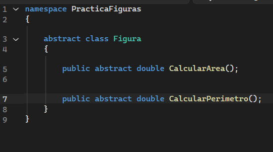 | 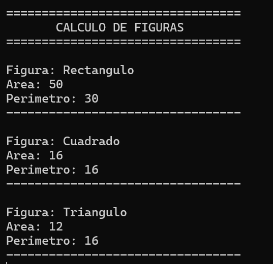 |

---

## 🧾 Proyecto 2 – Serialización JSON

### 📝 Descripción
Programa de consola mínimo que crea un **objeto anónimo** con datos de una persona y lo **serializa a texto JSON** usando la librería Newtonsoft.Json.

### 🛠️ Tecnologías
 

### ⚙️ Cómo funciona
1. Se declara `persona` como tipo anónimo con `Nombre`, `Edad` y `Ciudad`.
2. `JsonConvert.SerializeObject(persona)` convierte el objeto en una cadena JSON.
3. `Console.WriteLine(json)` imprime el resultado.

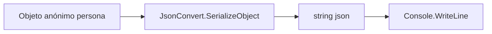

### 🖥️ Salida esperada
```json
{"Nombre":"Cristell","Edad":20,"Ciudad":"Ingenieria en Sistemas"}
```

### 🧩 Elementos principales

| Elemento | Función |
| :-- | :-- |
| Tipo anónimo `persona` | Contiene los datos a serializar |
| `JsonConvert.SerializeObject` | Convierte el objeto a JSON |
| Paquete NuGet `Newtonsoft.Json 13.0.4` | Librería de serialización |

### 🧠 Conceptos implementados
`Serialización` · `JSON` · `Tipos anónimos` · `Paquetes NuGet` · `Top-level statements` · `Salida por consola`

### 📸 Capturas

| Código | Ejecución |
| :-: | :-: |
| 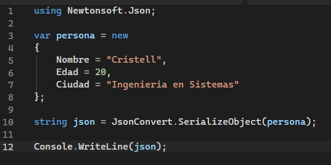 | 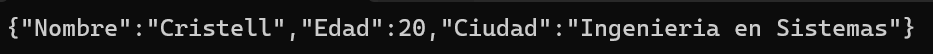 |

---

## 🔐 Proyecto 3 – LoginBCrypt (login seguro)

### 📝 Descripción
Aplicación de escritorio **Windows Forms** con inicio de sesión. Las contraseñas **nunca se guardan en texto plano**: se almacenan como hash **BCrypt** en una base de datos **SQLite**. Permite crear usuarios y registra cada intento de login.

### 🛠️ Tecnologías
  

### ⚙️ Cómo funciona
1. Al iniciar, `Program.cs` crea la BD `LoginBCrypt.db` (junto al ejecutable) y, si la tabla está vacía, el usuario de prueba **`victor` / `Victor123*`**.
2. `FormLogin` pide usuario y contraseña; `UsuarioService.IniciarSesion` busca el hash y lo compara con `BCrypt.Verify`.
3. Cada intento se guarda en `IntentosLogin` como `Exitoso` o `Fallido`.
4. Si es correcto se abre `FormPrincipal`: bienvenida, formulario **Crear usuario** (evita duplicados) y tabla de usuarios (sin mostrar el hash).

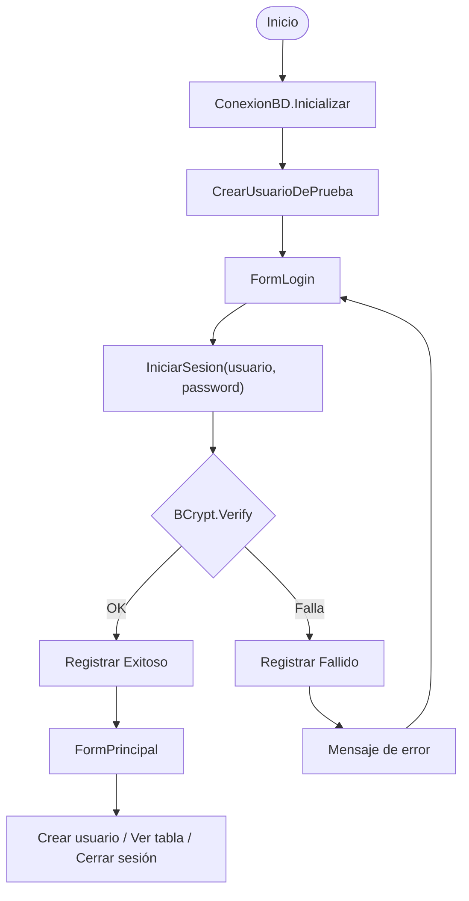

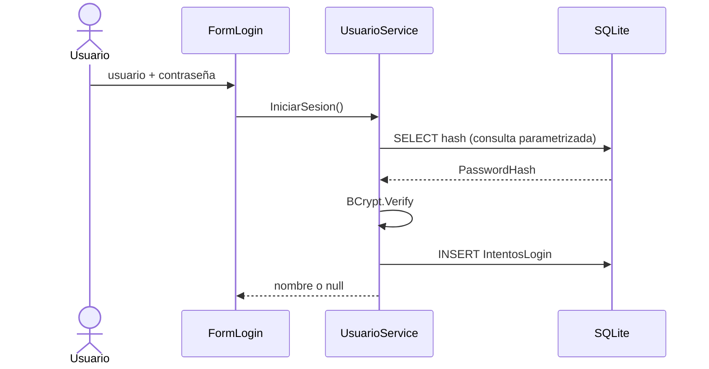

### 🧩 Clases y archivos

| Archivo | Responsabilidad |
| :-- | :-- |
| `Program.cs` | Punto de entrada; prepara BD y abre el login |
| `Datos/ConexionBD.cs` | Cadena de conexión y creación de tablas |
| `Servicios/UsuarioService.cs` | `CrearUsuarioDePrueba`, `IniciarSesion`, `CrearUsuario`, `ObtenerUsuarios`, `RegistrarIntento` |
| `FormLogin.cs` | Pantalla de inicio de sesión |
| `FormPrincipal.cs` | Pantalla principal con alta de usuarios y `DataGridView` |

### 🗄️ Modelo de datos

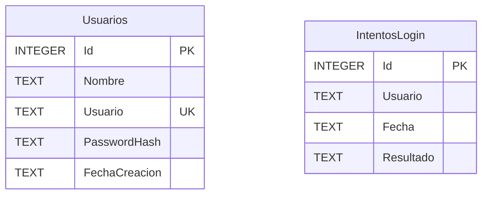

### 🧠 Conceptos implementados
`Hashing con sal (BCrypt)` · `Consultas parametrizadas (anti SQL injection)` · `Capa de servicios` · `CRUD con SQLite` · `Restricción UNIQUE` · `Windows Forms` · `DataGridView` · `Auditoría de intentos` · `Manejo de excepciones`

### 📸 Capturas

| Login | Error de login |
| :-: | :-: |
| 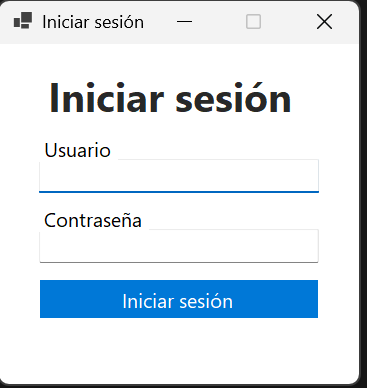 | 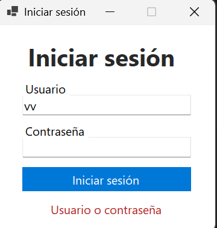 |

| Pantalla principal | Usuario creado |
| :-: | :-: |
| 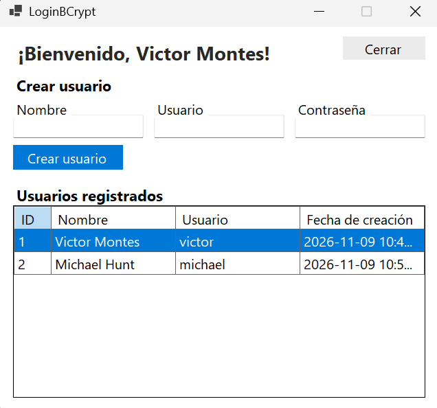 | 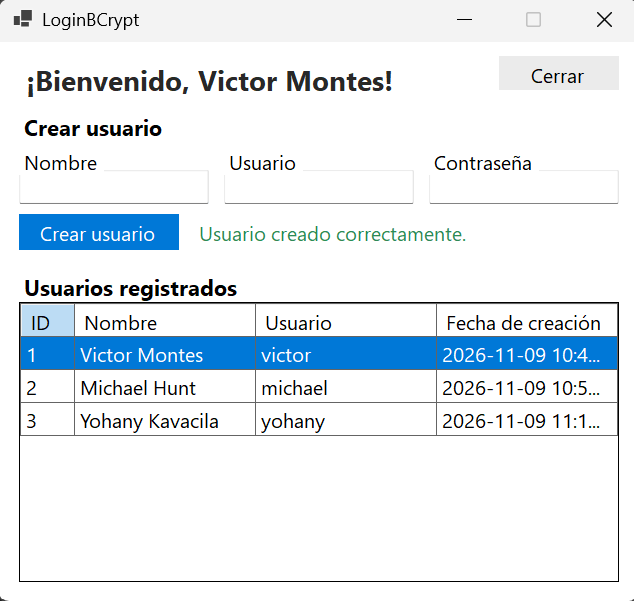 |

| Usuario duplicado |
| :-: |
| 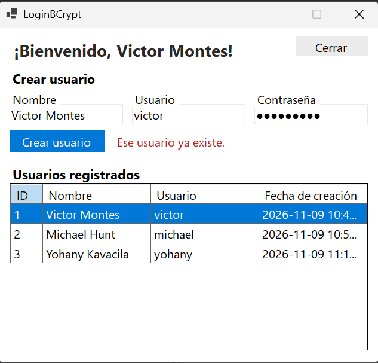 |

---

## ▶️ Cómo ejecutar

Requisito: **.NET SDK 10** (el proyecto 3 requiere Windows).

```bash
dotnet run --project "Problema # 1- Clase abstracta/Problema # 1- Clase abstracta"
dotnet run --project "Problema #2 - JSON/Problema #2 - JSON"
dotnet run --project "LoginBCrypt/LoginBCrypt"
```

---

## 🧱 Estructura del repositorio

```text
Parcial #3/
├── Banner.jpg
├── README.md
├── docs/images/                         ← capturas 
├── Problema # 1- Clase abstracta/       ← Proyecto 1
│   └── Figuras/ (Figura, Rectangulo, Cuadrado, Triangulo)
├── Problema #2 - JSON/                  ← Proyecto 2
└── LoginBCrypt/                         ← Proyecto 3
    ├── Datos/ConexionBD.cs
    └── Servicios/UsuarioService.cs
```

<p align="center"><sub>👨‍💻 Victor Montes · HPA 3 · Semestre VI</sub></p>
